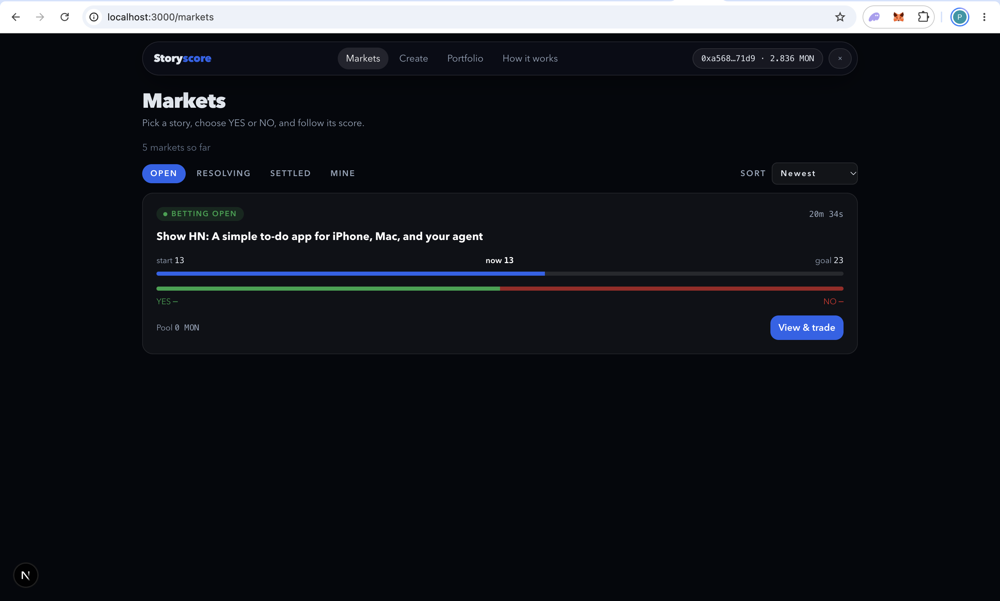
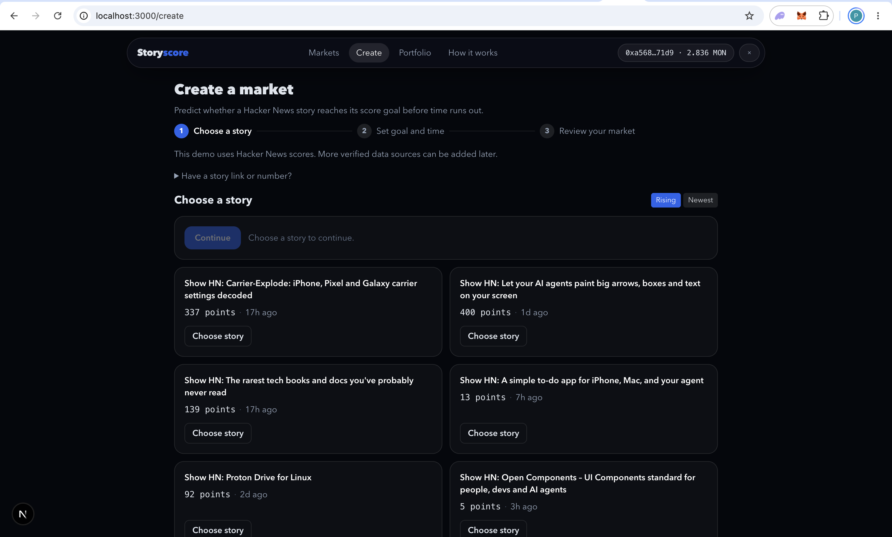
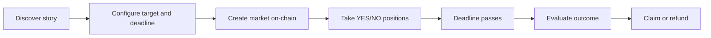
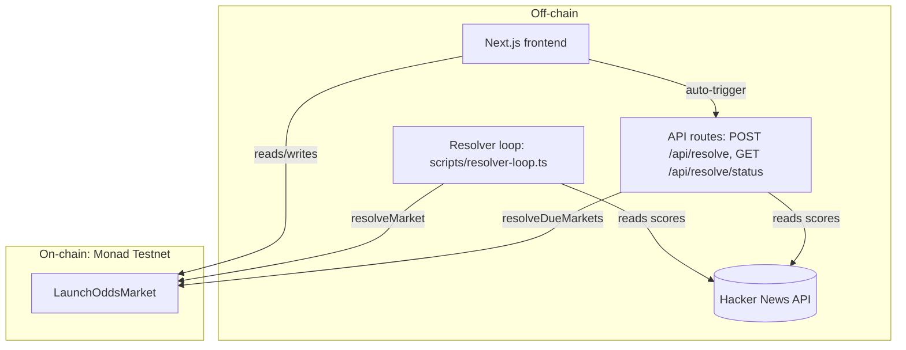

# Storyscore

A prediction-market application for Hacker News story-score milestones on Monad. People create markets around a story's future score, take YES or NO positions denominated in MON, track the outcome, and settle positions under the market's on-chain rules.

[](https://github.com/pk1427/LaunchOdds)
[](https://docs.monad.xyz/developer-essentials/testnet.md)
[](https://nextjs.org)

- **Repository:** https://github.com/pk1427/LaunchOdds
- **Live app:** not yet configured — no public deployment URL was found in this repository. This must be supplied before the README is complete for submission. (`http://localhost:3000` is local development only, not a demo URL.)
- **Contract (Monad Testnet):** [`0xD528703a9A6eF6Cbb04d6B1B7d79D5C4ce126187`](https://testnet.monadvision.com/address/0xD528703a9A6eF6Cbb04d6B1B7d79D5C4ce126187)
- **Deploy transaction:** [`0x6d62ca295d46affc5a7c695b26c565438a01512bb97294b978633ece3e71b705`](https://testnet.monadvision.com/tx/0x6d62ca295d46affc5a7c695b26c565438a01512bb97294b978633ece3e71b705)

## 30-second pitch

Conventional prediction markets only cover venues that already exist — elections, sports, prices. Storyscore opens markets on **emerging internet stories that have no trading venue**: will this Hacker News launch reach its score milestone before the deadline? Pick a live Show HN story, set a target and a deadline, stake MON on YES or NO, and let a transparent score rule (plus a disclosed, trusted resolver) settle it. Fully working on Monad Testnet with a verified deployment, reproducible setup, and honest trust documentation.

## Screenshots

### 1. Markets Discovery

Explore Hacker News stories and view their prediction markets.

<p align="center">
  
</p>

### 2. Create a Market

Select a Hacker News story, configure its score target and deadline, and review the market before confirming the on-chain transaction.

<p align="center">
  
</p>

### 3. YES/NO Trading and Score Progress

Track a story's starting score, current score, target, market pools, and countdown. Choose YES or NO and review the estimated payout before placing a position.

<p align="center">
  
</p>

## Product overview

Storyscore is for anyone who spots momentum early — a launch gaining traction on Hacker News — and wants to price that belief. Hacker News scores are a good underlying because they are public, numeric, fast-moving, and update in real time, yet no exchange lists them. That gap is the innovation: markets around emerging story outcomes that lack a dedicated trading venue.

User flow:



Illustrative scenario (not a claim about a live market): a story starts at 399 points. A creator sets a target of 402 with a 10-minute deadline. Participants stake MON on YES (reaches 402 in time) or NO (does not). After the deadline the resolver reports the live score; YES wins if and only if the reported score is at least 402.

## Features

Confirmed in the source code:

- **Story discovery** — live Show HN stories from the Hacker News API, with Rising/Newest sorting and incremental loading.
- **Paste-by-link** — add a market candidate from an HN link or story ID.
- **Market creation wizard** — choose story → set score goal (`+1/+2/+3/+5/+10`) and deadline (`3m/5m/10m/30m/1h`) → review → on-chain `createMarket`.
- **YES/NO positions** — one side per wallet per market, MON stakes, preset amounts, live payout preview from real pool data.
- **Score and pool tracking** — live HN score, progress bar, YES/NO distribution, countdowns, phase labels.
- **Markets and portfolio** — filterable market list (Open/Resolving/Settled/Mine), per-wallet positions grouped Active/Claimable/Claimed/Lost.
- **Claims and refunds** — pull-based `claim`; permissionless `refundUnresolvedMarket` after the grace period.
- **Resolution** — trusted resolver submits the live HN score on-chain; in-app auto-trigger plus a manual resolver fallback.
- **Transaction feedback** — wallet-confirm → submitted → confirmed/reverted toasts with explorer links.

Known limitations: resolution depends on one centralized resolver and the public HN API; short deadlines on a lagging testnet need buffer (see `contracts/DEPLOY.md` demo risks); no mainnet deployment.

## Architecture

| Component | Implementation |
|---|---|
| Frontend | Next.js 15 App Router + TypeScript + Tailwind v3 + wagmi/viem v2 (`frontend/`) |
| Protocol | Solidity `LaunchOddsMarket.sol`, Foundry (`contracts/`), OpenZeppelin 5.7.0 (`Ownable2Step`, `ReentrancyGuard`, `Math.mulDiv`) |
| Chain | Monad Testnet, chain ID `10143` |
| Data source | Hacker News Firebase API (`https://hacker-news.firebaseio.com/v0`) — `showstories` feed plus per-item reads |
| Resolver | Server-only `resolveDueMarkets` (`frontend/src/lib/server/resolver.ts`): poll loop (`scripts/resolver-loop.ts`), one-off mode, `POST /api/resolve`, and `GET /api/resolve/status` |



On-chain: market creation, positions, resolution, claims, refunds, and all money movement. Off-chain (centralized, not decentralized): the HN API, the resolver key holder, the Next.js hosting, and RPC endpoints.

## Deployment (verified)

Cross-checked against `contracts/DEPLOY.md` and the repo's broadcast/config files:

| Item | Value |
|---|---|
| Network | Monad Testnet |
| Chain ID | `10143` |
| RPC | `https://testnet-rpc.monad.xyz` |
| Contract (`LaunchOddsMarket`) | `0xD528703a9A6eF6Cbb04d6B1B7d79D5C4ce126187` |
| Explorer | https://testnet.monadvision.com/address/0xD528703a9A6eF6Cbb04d6B1B7d79D5C4ce126187 |
| Source verification | Partial Sourcify match via MonadVision (metadata-hash difference only) |
| `owner()` = `resolver()` | `0x659f1ddf3Afa31029B990D2202Df8B2094eE012E` |
| `resolutionGracePeriod()` | `600` s · betting locks 60 s before expiry · expiry within 120 s–30 d |

Testnet only: MON here has no real-world value. This is **not** a mainnet deployment.

The app's wallet modal adds/switches to Monad Testnet for you (chain ID `10143`); test MON comes from https://faucet.monad.xyz. Never share private keys or seed phrases with anyone.

## Getting started

### Prerequisites

- **Node.js** 20 LTS recommended (Next.js 15 requires ≥ 18.18). Package manager: **npm** (repo uses `package-lock.json`).
- **Foundry v1.8+** for contract work (`contracts/foundry.toml`, per `contracts/DEPLOY.md`).
- **Git**.
- A browser wallet (e.g. MetaMask) plus testnet MON from the faucet above.

### Clone and install

```sh
git clone https://github.com/pk1427/LaunchOdds.git
cd LaunchOdds
cd frontend && npm install        # frontend deps (independent)
cd ../contracts && forge build    # contract deps via Foundry (independent)
```

### Run the frontend

```sh
cd frontend
npm install
cp .env.example .env.local   # then fill in real values (never commit)
npm run dev                  # app at http://localhost:3000
```

`NEXT_PUBLIC_CONTRACT_ADDRESS` is required; without it the app shows a configuration notice instead of markets. See [Environment variables](#environment-variables).

### Run tests and checks

Contracts (`contracts/`):

```sh
forge build
forge fmt --check
forge test                                                # full suite
forge test --match-contract LaunchOddsMarketTest          # units only
forge test --match-contract LaunchOddsMarketFuzzTest      # fuzz only
forge test --match-contract LaunchOddsInvariantTest -vvv  # invariants only
```

Frontend (`frontend/`): there are no frontend unit-test or lint scripts. Available checks:

```sh
npx tsc --noEmit   # type checking
npm run build      # production build (also type-checks)
```

### Run the resolver

The resolver is the server process that submits live HN scores for expired markets. It needs the private key of the on-chain resolver wallet (server env only).

```sh
cd frontend
npm run resolver          # loop every POLL_INTERVAL_MS (default 10s)
npm run resolver:once     # single pass
DRY_RUN=true npm run resolver:once   # report only, send nothing
npm run watch-score -- <storyId>     # sanity-check a story's score first
```

The running app also auto-triggers `POST /api/resolve` while a market awaits resolution, so the loop mainly covers downtime. `GET /api/resolve/status` reports the on-chain resolver and whether a key is configured (never the key itself).

## Environment variables

Template: `frontend/.env.example`. Copy it to `frontend/.env.local` (git-ignored) and fill in values. Placeholder values only — no real secrets below.

| Variable | Required | Visibility | Purpose |
|---|---|---|---|
| `NEXT_PUBLIC_CONTRACT_ADDRESS` | Yes | Browser-visible | Deployed market contract |
| `NEXT_PUBLIC_MONAD_RPC` | No | Browser-visible | RPC override (default `https://testnet-rpc.monad.xyz`) |
| `NEXT_PUBLIC_AUTO_RESOLVE` | No | Browser-visible | In-app resolve auto-trigger (default `true`) |
| `RESOLVER_PRIVATE_KEY` | For resolving | Server-only | Key of the on-chain resolver wallet |
| `POLL_INTERVAL_MS` | No | Server-only | Resolver loop interval (default `10000`) |
| `DRY_RUN` | No | Server-only | `true` = report without sending |

`RESOLVER_PRIVATE_KEY` must never use the `NEXT_PUBLIC_` prefix and must never be committed. `.env.local` is git-ignored in both root and `frontend/` gitignore files.

## Market rules

From `contracts/src/LaunchOddsMarket.sol` (see `contracts/README.md` for the function reference):

- **Creation** — `createMarket(sourceId, baselineScore, targetScore, expiry, metadataHash)`; requires `targetScore > baselineScore`, nonzero source/metadata, expiry within 120 s–30 d from now. Returns the market ID.
- **Positions** — `takePosition(marketId, isYes)` payable, only while open and before `expiry − 60 s` (bets at/after the lock revert with `BettingClosed`). Same-side top-ups aggregate; taking the opposite side reverts. One side per wallet per market.
- **Payouts** — winners split the losing pool proportionally: `payout = stake + floor(losingPool × stake / winningPool)`, using final on-chain pools. No protocol fees. The last unclaimed winner receives the exact `remainingLiability`, absorbing rounding dust so nothing locks permanently. Empty winning pool means stakes are returned, not divided.
- **Resolution** — resolver-only `resolveMarket(marketId, finalScore, evidenceHash)` after expiry. YES wins iff `finalScore >= targetScore`. Empty winning side settles as `Refunded`.
- **Claims** — pull-based `claim`; winners and refund recipients withdraw themselves. Eligibility always comes from `previewClaim`, never from frontend estimates.
- **Refunds** — permissionless `refundUnresolvedMarket` after `expiry + 600 s` grace period; refunds return exact stakes.

Worked example (illustrative, matches the contract formula): pools stand at YES 0.2 / NO 0.1 MON and you stake 0.1 MON on YES (final YES pool 0.3). If YES wins, estimated payout = `0.1 + (0.1 × 0.1 / 0.3)` ≈ **0.1333 MON**, which **includes your 0.1 principal** (net ≈ +0.0333). Later bets and on-chain floor division change the exact figure.

## Trust and limitations

Resolution is **trusted and centralized**: a single resolver key holder reports the HN score; the contract enforces *who* may resolve and the YES/NO rule but cannot verify the API data is truthful. If the resolver is dead, disabled, or the HN API is unreachable, markets sit unresolved until anyone triggers permissionless refunds after the grace period. There is no oracle decentralization, no independent verification, and no security audit. The frontend, hosting, RPC, and HN API are ordinary centralized infrastructure. Treat everything here as experimental testnet software.

## Repository map

```
LaunchOdds/
├── README.md                 # this file
├── docs/images/              # suggested screenshot location
├── contracts/
│   ├── README.md             # protocol reference (functions, payouts, tests)
│   ├── DEPLOY.md             # testnet deploy runbook + verified records
│   ├── src/LaunchOddsMarket.sol
│   ├── script/DeployLaunchOddsMarket.s.sol  # deployment (+ smoke-test.sh)
│   ├── test/                 # unit, fuzz, invariant suites
│   ├── abi/LaunchOddsMarket.json            # exported ABI (mirrored to frontend)
│   ├── broadcast/            # deployment artifacts (chain 10143)
│   └── foundry.toml
└── frontend/
    ├── README.md             # frontend + resolver operator guide
    ├── package.json          # dev/build/start/resolver/watch-score scripts
    ├── .env.example          # safe env template (copy to .env.local)
    ├── src/app/              # routes: /, markets, markets/[id], create,
    │                         # portfolio, how-it-works, api/resolve[/status]
    ├── src/components/       # header, wallet, market cards, trade UI, modals
    ├── src/lib/              # chain/wallet config, HN client, payout math,
    │                         # contract hooks, server/resolver.ts
    ├── scripts/              # resolver-loop, watch-score, sanity-read
    └── abi/                  # contract ABI used by the app
```

## Security and disclaimer

- Never commit secrets; review `git diff` before pushing. Never share private keys or seed phrases.
- Testnet contracts and the HN API are experimental; use test MON only.
- Review every transaction in your wallet before approving; displayed payouts are estimates until final on-chain resolution.
- This is a hackathon testnet project, unaudited and without security guarantees.

## Contributing and license

- Report bugs via [GitHub Issues](https://github.com/pk1427/LaunchOdds/issues); propose changes via pull requests.
- Before submitting: `forge fmt --check` + `forge test` (contracts), `npx tsc --noEmit` + `npm run build` (frontend).
- **No license file exists in this repository.** Until the maintainer adds one, the project is not licensed under any open-source terms — flagged for the maintainer to decide.

## Hackathon Demo Checklist

- [x] Public repo: https://github.com/pk1427/LaunchOdds
- [ ] Public live app: **not configured** — supply the deployment URL.
- [x] Monad Testnet chain ID `10143`, contract `0xD528703a9A6eF6Cbb04d6B1B7d79D5C4ce126187` ([explorer](https://testnet.monadvision.com/address/0xD528703a9A6eF6Cbb04d6B1B7d79D5C4ce126187), partial Sourcify match).
- [x] Setup instructions in this README ([Getting started](#getting-started)).
- [ ] Demo flow rehearsal: fund two wallets → create market (10+ min buffer) → bet YES/NO → expiry → resolver submits score → winners claim. Known limitation: centralized resolver + HN API dependency (disclosed above and in-app).
